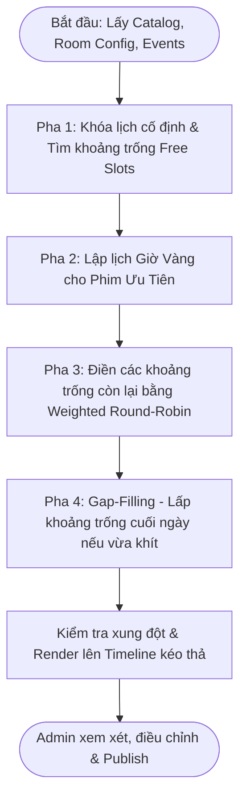

# Thiết Kế & Thuật Toán: Hệ Thống Tự Động Lập Lịch Chiếu Phim
*Unfinished
**Project:** DA1-CinemaMS (Cinema Management System)  
**Tài liệu:** Đánh giá tính khả thi, đặc tả nghiệp vụ và đề xuất thuật toán tự động lập lịch chiếu phim (Auto-Showtime Scheduling)  
**Ngày lập:** 2026-09-27  

---

## 1. Tổng Quan & Mục Tiêu Nghiệp Vụ

Hệ thống cho phép Quản trị viên (Admin) tự động sinh lịch chiếu phim cho các phòng chiếu trong rạp theo khoảng thời gian tùy chọn, sau đó hỗ trợ xem xét, điều chỉnh trực quan bằng giao diện kéo thả (Drag & Drop) trước khi xuất bản (Publish) ra hệ thống đặt vé.

### Quy trình nghiệp vụ cốt lõi:
1. **Thiết lập đầu vào:**
   - Chọn Rạp $\rightarrow$ Phòng chiếu (hoặc chọn Rạp và tự động chạy cho toàn bộ các phòng).
   - Chọn khung thời gian mở/đóng cửa của phòng chiếu.
   - Chọn Catalog phim khả dụng và xác định độ ưu tiên cho từng phim.
   - Thiết lập khung giờ vàng (Golden Hours / Prime Time).
   - Thiết lập thời gian giãn cách giữa 2 suất chiếu (Dọn dẹp vệ sinh + Chiếu quảng cáo/trailer).
   - Chọn khoảng ngày cần tự động tạo lịch (Date range).
2. **Sinh lịch tự động theo ngày:**
   - Bảo toàn các lịch sự kiện (Event), suất chiếu đã tồn tại trước đó.
   - Ưu tiên xếp phim có độ ưu tiên cao vào khung giờ vàng.
   - Phân bổ các phim còn lại theo thuật toán luân phiên có trọng số (Weighted Round-Robin).
   - Quét và lấp đầy khoảng trống cuối ngày (Gap-filling) nếu còn đủ thời lượng cho một bộ phim.
3. **Hiệu chỉnh & Xuất bản:**
   - Hiển thị trực quan trên trục thời gian (Timeline).
   - Cho phép Admin kéo thả, thay đổi thời gian bắt đầu hoặc xóa suất chiếu.
   - Kiểm tra va chạm (Collision/Conflict Detection) theo thời gian thực.
   - Lưu trữ và xuất bản (Publish) toàn bộ lịch chiếu vào cơ sở dữ liệu.

---

## 2. Đánh Giá Tính Khả Thi (Feasibility Analysis)

| Tiêu chí | Đánh giá | Chi tiết kỹ thuật |
| :--- | :---: | :--- |
| **Tính khả thi tổng thể** | **9.5 / 10** | Bản chất là bài toán **Interval Scheduling** kết hợp **Knapsack Problem**, hoàn toàn khả thi cả về mặt thuật toán, hiệu năng và giao diện người dùng. |
| **Hiệu năng & Độ phức tạp** | **Rất cao (10/10)** | Số lượng phòng của một rạp dao động từ 3–15 phòng, mỗi phòng có 4–8 suất chiếu/ngày. Không gian tìm kiếm rất nhỏ ($N \le 100$), thuật toán Heuristic thực thi chỉ mất **10–50ms**. Có thể chạy trực tiếp trên Client (Browser) hoặc qua API Backend. |
| **UX Kéo thả (Timeline Drag & Drop)** | **Rất cao (9/10)** | Sử dụng cơ chế kéo thả theo lưới thời gian (Snapping 5–15 phút). Kiểm tra va chạm tức thời. Hiện mã nguồn dự án đã tích hợp thư viện `@dnd-kit/core` trong component `AutoShowtimeCreator`. |
| **Tính toàn vẹn dữ liệu** | **Rất cao (9/10)** | Đảm bảo tuyệt đối không có 2 suất chiếu trùng giờ trong cùng 1 phòng bằng thuật toán kiểm tra giao đoạn thời gian $[S_1, E_1] \cap [S_2, E_2] = \emptyset$. |
| **Khả năng mở rộng (Scalability)** | **Rất cao (9/10)** | Dễ dàng mở rộng từ việc lập lịch 1 phòng $\rightarrow$ lập lịch hàng loạt tất cả các phòng trong rạp $\rightarrow$ lập lịch cho nhiều ngày liên tiếp. |

---

## 3. Phân Loại Các Ràng Buộc (Constraints Formulation)

### 3.1. Ràng buộc cứng (Hard Constraints - Bắt buộc 100%)
1. **Không chồng chéo (No Overlap):**
   $$\forall i \ne j: [Start_i, End_i] \cap [Start_j, End_j] = \emptyset$$
2. **Khung giờ hoạt động của phòng (Operating Window):**
   $$Start_i \ge OpenTime_{Room} \quad \text{và} \quad End_i \le CloseTime_{Room}$$
3. **Thời gian giãn cách tối thiểu (Buffer / Turnaround Time):**
   Giữa hai suất chiếu liên tiếp $i$ và $i+1$, khoảng cách nghỉ $\Delta t \ge TurnaroundTime$:
   $$Start_{i+1} - End_i \ge CleaningTime + AdsTime$$
4. **Bảo toàn lịch cố định (Locked Blocks Protection):**
   Các sự kiện thuê rạp, fan meeting, hoặc các suất chiếu đã có khách đặt vé trước đó là **bất biến**, thuật toán phải tìm cách lấp vào các khoảng trống xung quanh mà không được dịch chuyển các khối này.

### 3.2. Ràng buộc mềm (Soft Constraints - Mục tiêu tối ưu)
1. **Ưu tiên khung giờ vàng (Prime Time Optimization):** Phim có điểm ưu tiên cao nhất phải được ưu tiên phân bổ vào khung giờ đông khách nhất (18:00 – 21:30 ngày thường, 13:00 – 21:30 cuối tuần).
2. **Công bằng phân bổ (Catalog Round-Robin):** Tránh trường hợp một bộ phim chiếm trọn toàn bộ các suất chiếu trong ngày, các phim trong catalog phải được xoay vòng công bằng theo tỷ lệ trọng số.
3. **Tối thiểu hóa thời gian phòng trống (Minimize Idle Time):** Tối ưu hóa thời gian phòng rảnh rỗi bằng kỹ thuật Best-Fit Gap Filling ở cuối ngày.
4. **Lệch giờ giữa các phòng (Staggering - Áp dụng cho rạp nhiều phòng):** Suất chiếu giữa các phòng không nên bắt đầu cùng một lúc để tránh quá tải quầy vé và quầy bắp nước.

---

## 4. Đặc Tả Thuật Toán Đề Xuất

### Thuật toán: **Priority-Weighted Round-Robin with Golden-Hour Pre-allocation & Knapsack Gap Filling**

Thuật toán kết hợp Heuristic tham lam (Greedy) và phân bổ theo vòng tròn có trọng số, chia làm **4 Pha thực thi**:



---

### Chi Tiết Từng Pha Thuật Toán

#### Pha 1: Khóa lịch cố định (Locked Blocks) & Tìm các khoảng trống khả dụng (Free Slots)
1. Lấy danh sách toàn bộ các suất chiếu đã tồn tại và các sự kiện trong ngày của phòng chiếu.
2. Sắp xếp danh sách theo thời gian bắt đầu tăng dần: $B_1, B_2, \dots, B_k$.
3. Trừ các khối đã khóa ra khỏi khoảng thời gian mở cửa $[OpenTime, CloseTime]$, ta thu được tập hợp các khoảng thời gian trống khả dụng:
   $$\mathcal{S} = \{ [s_1, e_1], [s_2, e_2], \dots, [s_m, e_m] \}$$

#### Pha 2: Lập lịch cho Khung Giờ Vàng (Golden Hour Allocation)
1. Tìm trong tập $\mathcal{S}$ các khoảng trống giao nhau với khung giờ vàng $[GoldenStart, GoldenEnd]$.
2. Lọc danh sách phim có điểm ưu tiên cao nhất ($Priority = \max$).
3. Đặt suất chiếu cho phim ưu tiên vào vị trí tối ưu trong khung giờ vàng (ví dụ: `19:00` hoặc `19:30`):
   $$\text{BlockDuration} = \text{Duration}_{movie} + \text{CleaningMinutes} + \text{AdsMinutes}$$
4. Cập nhật lại tập hợp khoảng trống $\mathcal{S}$ sau khi đã đặt suất chiếu giờ vàng.

#### Pha 3: Phân bổ các khoảng trống còn lại theo Weighted Round-Robin
1. Xây dựng hàng đợi tuần hoàn (Cyclic Queue) từ Catalog phim dựa trên trọng số ưu tiên:
   - Phim Priority 3 xuất hiện 3 lần trong chu kỳ.
   - Phim Priority 2 xuất hiện 2 lần.
   - Phim Priority 1 xuất hiện 1 lần.
2. Với mỗi khoảng trống $[s, e] \in \mathcal{S}$ (duyệt từ sáng đến tối):
   - Đặt con trỏ $cursor = s$.
   - Lần lượt lấy phim từ hàng đợi Round-Robin.
   - Kiểm tra nếu $cursor + \text{BlockDuration} \le e$:
     - Đặt suất chiếu mới: $[cursor, cursor + \text{MovieDuration}]$.
     - Cập nhật $cursor = cursor + \text{BlockDuration}$.
     - Chuyển sang phim tiếp theo trong hàng đợi.
   - Nếu phim hiện tại không vừa, thử các phim tiếp theo trong hàng đợi.

#### Pha 4: Lấp đầy khoảng trống cuối ngày (Best-Fit Gap Filling)
1. Khi $cursor$ tiến sát $CloseTime$ và không thể đặt thêm phim tiếp theo theo thứ tự Round-Robin:
2. Quét qua toàn bộ Catalog, tìm phim có:
   $$\text{BlockDuration} \le (CloseTime - cursor)$$
3. Nếu có nhiều phim thỏa mãn, chọn phim có $\text{BlockDuration}$ lớn nhất và vừa khít nhất với thời gian còn lại (Best-Fit), tránh lãng phí thời gian mở cửa của rạp.

---

### Mã Giả Thuật Toán (Pseudocode)

```typescript
function generateDailySchedule(
  movies: Movie[],
  constraints: ScheduleConstraints, // openTime, closeTime, bufferMinutes, goldenHours
  lockedBlocks: ShowtimeBlock[]
): ShowtimeBlock[] {
  const { openTime, closeTime, bufferMinutes, goldenHours } = constraints;
  const blocks: ShowtimeBlock[] = [];

  // Bước 1: Tính toán các khoảng trống khả dụng (Free Slots)
  let freeSlots = computeFreeSlots(openTime, closeTime, lockedBlocks);

  // Bước 2: Xếp phim ưu tiên vào khung giờ vàng
  const priorityMovies = [...movies].sort((a, b) => b.priority - a.priority);
  const goldenSlot = freeSlots.find(slot => isOverlapping(slot, goldenHours));
  
  if (goldenSlot && priorityMovies.length > 0) {
    const topMovie = priorityMovies[0];
    const blockDuration = topMovie.durationMinutes + bufferMinutes;
    const goldenStart = Math.max(goldenSlot.start, goldenHours.start);

    if (goldenStart + blockDuration <= goldenSlot.end) {
      blocks.push(createBlock(topMovie, goldenStart, topMovie.durationMinutes));
      // Tách slot bị chiếm thành các slot nhỏ hơn
      freeSlots = updateFreeSlotsAfterPlacement(freeSlots, goldenStart, goldenStart + blockDuration);
    }
  }

  // Bước 3: Xếp lịch các slot còn lại theo Weighted Round-Robin
  const queue = buildWeightedQueue(movies);
  let queueIdx = 0;

  for (const slot of freeSlots) {
    let cursor = slot.start;
    let attempts = 0;

    while (cursor < slot.end && attempts < queue.length) {
      const movie = queue[queueIdx % queue.length];
      const totalBlock = movie.durationMinutes + bufferMinutes;

      if (cursor + totalBlock <= slot.end) {
        blocks.push(createBlock(movie, cursor, movie.durationMinutes));
        cursor += totalBlock;
        queueIdx++;
        attempts = 0;
      } else {
        queueIdx++;
        attempts++;
      }
    }

    // Bước 4: Gap Filling cho khoảng trống cuối cùng của slot
    const remainingTime = slot.end - cursor;
    const fittingMovie = findBestFitMovie(movies, remainingTime, bufferMinutes);
    if (fittingMovie) {
      blocks.push(createBlock(fittingMovie, cursor, fittingMovie.durationMinutes));
    }
  }

  return blocks.sort((a, b) => a.startMinutes - b.startMinutes);
}
```

---

## 5. Khảo Sát Thực Tế & Thiết Lập Tham Số Chuẩn

### 5.1. Khảo sát thời gian đóng/mở phòng của các rạp tại Việt Nam
Dựa trên khảo sát thực tế tại các cụm rạp CGV, Lotte Cinema, Beta Cinemas, BHD Star, Galaxy Cinema:

| Tham số | Giá trị thực tế | Khuyến nghị cấu hình mặc định |
| :--- | :---: | :---: |
| **Giờ mở cửa (Open Time)** | 08:00 – 08:30 | **08:30** (Suất đầu tiên bắt đầu khoảng 08:45 – 09:00) |
| **Giờ đóng cửa (Close Time)** | 23:30 – 01:00 (sáng hôm sau) | **23:45** (Suất cuối cùng bắt đầu lúc ~22:00) |
| **Thời gian dọn dẹp vệ sinh** | 10 – 15 phút (phòng thường), 20 – 25 phút (IMAX/Bed) | **15 phút** |
| **Thời gian chiếu Trailer/Ads** | 5 – 10 phút | **10 phút** |
| **Tổng Buffer giãn cách** | 15 – 25 phút | **20 phút** (10p dọn dẹp + 10p trailer) |

### 5.2. Khảo sát Khung Giờ Vàng (Golden Hours / Prime Time)
- **Thứ 2 đến Thứ 6:** `18:00 – 21:30` (Đông nhất: `19:00 – 20:30`).
- **Thứ 7, Chủ Nhật & Ngày Lễ:** `13:30 – 22:00` (Đông nhất: `15:00 – 17:00` và `19:00 – 21:00`).

---

## 6. Mô Hình Mở Rộng: Tự Động Lập Lịch Toàn Rạp (Multi-Room)

Khi mở rộng tính năng để Admin chỉ cần chọn **Rạp** và **Khoảng thời gian**, hệ thống sẽ xử lý thông minh qua các bước sau:

```
┌─────────────────────────────────────────────────────────────┐
│                 ADMIN CHỌN RẠP & KHOẢNG NGÀY                │
└──────────────────────────────┬──────────────────────────────┘
                               │
                               ▼
        ┌─────────────────────────────────────────────┐
        │  VÒNG LẶP THEO TỪNG NGÀY (Date in Range)    │
        └──────────────────────┬──────────────────────┘
                               │
                               ▼
        ┌─────────────────────────────────────────────┐
        │   VÒNG LẶP THEO TỪNG PHÒNG (Room in Theater)│
        │   - Lấy cấu hình Open/Close & Loại phòng   │
        └──────────────────────┬──────────────────────┘
                               │
              ┌────────────────┴────────────────┐
              ▼                                 ▼
   [Phòng Định Dạng Đặc Biệt]          [Phòng Tiêu Chuẩn 2D]
     (IMAX, 3D, VIP, Bed)              - Lệch giờ bắt đầu (Staggering)
   - Lọc Catalog đúng định dạng          tránh ùn tắc quầy vé/bắp nước
   - Ưu tiên phim bom tấn kỹ xảo       - Phim hot phân vào phòng nhiều ghế
              │                                 │
              └────────────────┬────────────────┘
                               │
                               ▼
        ┌─────────────────────────────────────────────┐
        │   TỔNG HỢP TIMELINE & KIỂM TRA VA CHẠM     │
        └──────────────────────┬──────────────────────┘
                               │
                               ▼
        ┌─────────────────────────────────────────────┐
        │       GIAO DIỆN XEM XÉT / KÉO THẢ / LƯU     │
        └─────────────────────────────────────────────┘
```

### Kỹ thuật Lệch Giờ Chiếu (Staggering Showtimes):
- Khi có 5 phòng chiếu, nếu tất cả đều bắt đầu lúc `19:00`, sảnh chờ và quầy bắp nước sẽ bị quá tải cục bộ, trong khi nhân viên soát vé không phục vụ kịp.
- **Giải pháp:** Hệ thống cộng thêm một khoảng dịch chuyển thời gian (offset):
  - Phòng 1: bắt đầu lúc `19:00`
  - Phòng 2: bắt đầu lúc `19:15`
  - Phòng 3: bắt đầu lúc `19:30`
  - Phòng 4: bắt đầu lúc `19:45`

---

## 7. Đề Xuất Tích Hợp Vào Mã Nguồn Hiện Tại

### 7.1. Các thành phần đã có trong dự án
- **`ShowtimeManagement.tsx`**: Trang quản trị suất chiếu, đã có bảng điều khiển và modal `AutoShowtimeCreator`.
- **`AutoShowtimeCreator.tsx`**: Đã dựng giao diện Timeline, thanh công cụ điều chỉnh thông số, danh sách chọn phim kèm độ ưu tiên.
- **`useAutoShowtime.ts`**: Hook quản lý trạng thái các block showtime, tương thích với thư viện kéo thả `@dnd-kit/core`.
- **`scheduleUtils.ts`**: Đã có hàm `runAutoFill` theo giải thuật Greedy ban đầu.

### 7.2. Các mục tiêu cải tiến & hoàn thiện
1. **Nâng cấp `ScheduleConstraints` (`types/schedule.ts`):**
   - Thêm `goldenHoursStart: string` (mặc định `'18:30'`).
   - Thêm `goldenHoursEnd: string` (mặc định `'21:30'`).
   - Thêm cấu hình hỗ trợ `staggerOffsetMinutes: number` (mặc định `15`).
2. **Nâng cấp thuật toán trong `scheduleUtils.ts`:**
   - Bổ sung logic Pha 2 (Ưu tiên khung giờ vàng).
   - Bổ sung logic Pha 4 (Lấp đầy khoảng trống Best-Fit cuối ngày thay vì ngắt vòng lặp).
3. **Mở rộng chế độ chạy Batch theo Rạp:**
   - Cho phép chọn nhiều phòng hoặc "Áp dụng cho tất cả các phòng trong rạp".
   - Tự động lấy danh sách `theaters[i].rooms` và chạy vòng lặp sinh lịch song song cho từng phòng.
