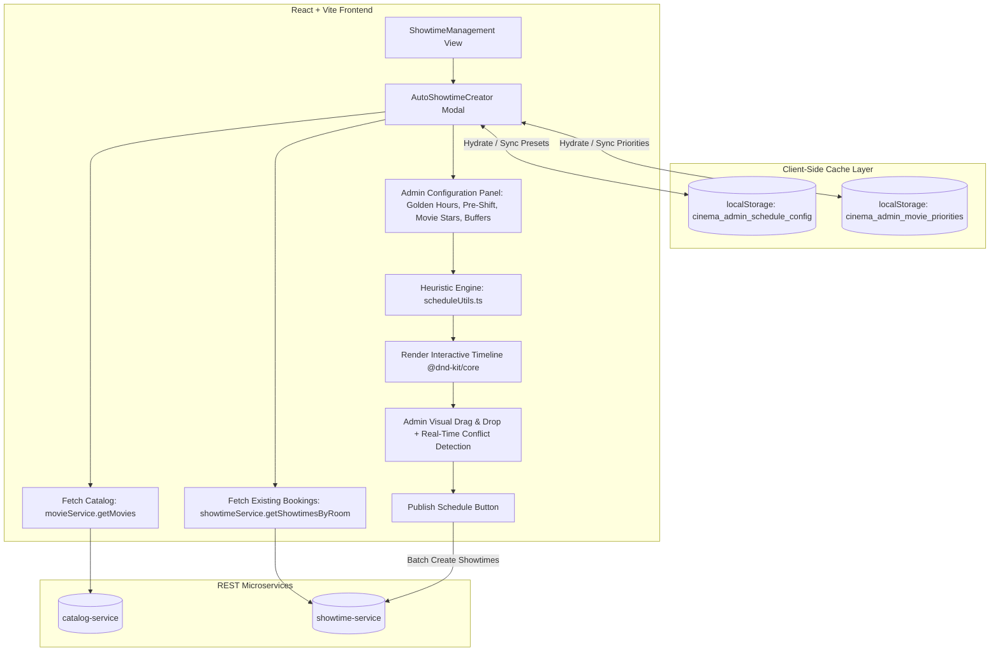
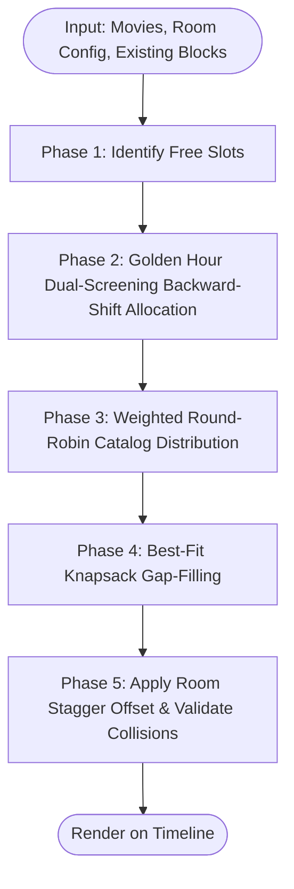

# Implementation Plan: Auto-Showtime Scheduling System

**Reference Document:** [`cinema-booking-system/docs/AUTO_SHOWTIME_SCHEDULING.md`](file:///c:/DoAn1/DA1-CinemaMS/cinema-booking-system/docs/AUTO_SHOWTIME_SCHEDULING.md)  
**Objective:** Implement multi-room automatic showtime scheduling with prime-time (Golden Hours) optimization, backward-shift dual-screening heuristics, priority movies, interactive timeline drag-and-drop (`@dnd-kit/core`), and **browser cache persistence (LocalStorage)** for admin scheduling presets with **zero backend database migrations**.

---

## 1. System Architecture & Data Flow



### Key Architectural Decision: Browser Cache vs. Database Persistence
- **No Database Migrations**: Operational heuristics like "Golden Hours" and temporary movie popularity change weekly and vary by cinema manager. Storing them in browser `localStorage` avoids schema modifications, cross-service migration debt, and API bloat.
- **Instant Persistence**: The admin's preferred operational hours, turnaround buffers, and golden hour windows are saved automatically across sessions, browser reloads, and different rooms.
- **Factory Reset**: Admins can revert to recommended system defaults (`08:30–23:45`, `18:30–21:30` Golden Hours) with a single click.

---

## 2. Browser Cache Persistence Design

### 2.1 Storage Keys & Data Schemas

#### 1. Scheduling Constraints (`localStorage: cinema_admin_schedule_config`)
```typescript
export interface ScheduleConstraints {
  openTime: string;              // "08:30" (Theater opening)
  closeTime: string;             // "23:45" (Theater closing)
  cleaningTimeMinutes: number;   // 15 (Cleaning turnaround)
  adsTimeMinutes: number;        // 10 (Trailers & commercials)
  goldenHoursStart: string;      // "18:30" (Prime time start)
  goldenHoursEnd: string;        // "21:30" (Prime time end)
  maxPreShiftMinutes: number;    // 45 to 60 (Allow shifting start backward to fit 2 prime evening screenings)
  staggerOffsetMinutes: number;  // 15 (Offset between adjacent halls to prevent lobby crowding)
}
```

#### 2. Movie Priority Cache (`localStorage: cinema_admin_movie_priorities`)
```typescript
export interface CachedMoviePriority {
  [movieId: number]: {
    priority: 1 | 2 | 3;         // 1 = Standard, 2 = High Demand, 3 = Blockbuster / Golden Hour
    isHot?: boolean;             // Highlight badge
    updatedAt: string;
  };
}
```

### 2.2 Storage Manager Hook (`useScheduleStorage.ts`)
A dedicated React hook manages synchronization with `localStorage`:
- **Hydration on Mount**: Pre-populates the setup modal with saved presets or standard defaults.
- **Save As Default**: Persists current form inputs to `localStorage`.
- **Reset to Factory**: Restores recommended Vietnamese cinema operational defaults:
  - Open: `08:30`, Close: `23:45`
  - Cleaning: `15 min`, Ads: `10 min`
  - Golden Hours: `18:30 – 21:30` (weekday default) or `13:30 – 22:00` (weekend default)
  - Pre-shift allowance: `45 min` (allows starts as early as `17:45`)
  - Stagger Offset: `15 min`

---

## 3. Algorithm Specification ([`scheduleUtils.ts`](file:///c:/DoAn1/DA1-CinemaMS/cinema-booking-system/frontend/src/utils/scheduleUtils.ts))

The core scheduling engine executes a **5-Phase Priority-Weighted Heuristic** with backward-shift dual prime optimization and hall staggering:



### Phase 1: Free Slot Discovery (Locked Block Protection)
1. Fetch all existing showtimes and locked event blocks for the selected date and room.
2. Sort chronologically: $B_1, B_2, \dots, B_k$.
3. Subtract locked ranges from $[OpenTime, CloseTime]$ to generate available intervals:
   $$\mathcal{S} = \{ [s_1, e_1], [s_2, e_2], \dots, [s_m, e_m] \}$$

---

### Phase 2: Golden Hour Dual-Screening Optimization (Backward-Shift Lookback)

#### 1. The Single-Movie Bottleneck Problem
If the algorithm rigidly aligns the first movie to start at `goldenHoursStart` (`18:30`):
- A typical blockbuster + turnaround buffer is ~140 min (`120 min runtime + 20 min buffer`).
- Movie 1 runs from `18:30` to `20:50`.
- Remaining time in Golden Hours (`18:30 – 21:30`): only **40 minutes** (`20:50 – 21:30`).
- A second movie cannot start within prime hours, leaving only **1 prime screening** and wasting 40–50 minutes of peak hall capacity.

#### 2. Real-World Audience Demographics
In commercial cinema operations, evening foot traffic divides into two profitable personas:
- **Persona A ("Watch First, Eat Later")**: Leaves work/school at 17:00, avoids rush-hour traffic, watches a film at `17:45`, and has dinner at `20:00`.
- **Persona B ("Eat First, Watch Later")**: Has dinner from 18:00 to 19:30, and arrives at the cinema for a `20:05 – 20:30` screening.

#### 3. Backward-Shift Heuristic
To capture both audiences and double prime-time box office potential, Phase 2 implements a lookback calculation:
1. **Direct Fit Test**: Check if 2 prime movies naturally fit in $[GoldenStart, GoldenEnd]$:
   $$\text{If } GoldenStart + BlockDuration_1 + BlockDuration_2 \le GoldenEnd \implies \text{Schedule sequentially without shift}$$
2. **Anchor Second Movie at Post-Dinner Peak**:
   $$TargetStart_2 = \min(GoldenStart + 90, GoldenEnd - BlockDuration_2 + 30) \approx 20:00 - 20:15$$
3. **Calculate Shifted Start for First Movie**:
   $$ShiftedStart_1 = TargetStart_2 - BlockDuration_1 \approx 17:40 - 17:45$$
4. **Operational Guardrail (Earliest Cutoff)**:
   $$EarliestAllowed = \max(FreeSlot.start, GoldenStart - maxPreShiftMinutes)$$
   - Constrained by `maxPreShiftMinutes = 45–60 min` (never earlier than `17:30`), ensuring screenings do not start while customers are still in the office/classroom.
5. **Execution**:
   - **Shift Succeeded**: Allocate Movie 1 at $ShiftedStart_1$ and Movie 2 at $TargetStart_2$. Both prime slots are captured!
   - **Fallback**: If the slot before `18:30` is blocked by a locked event, fall back to a single screening starting at $\max(FreeSlot.start, GoldenStart)$.
6. Split occupied slots and update $\mathcal{S}$.

---

### Phase 3: Weighted Round-Robin Catalog Allocation
1. Build a cyclic queue from selected movies weighted by their star rating:
   - Priority 3 (Blockbuster): appears 3 times per cycle.
   - Priority 2 (High): appears 2 times per cycle.
   - Priority 1 (Standard): appears 1 time per cycle.
2. For each remaining free slot in $\mathcal{S}$, advance cursor $c = s$:
   - Check if $c + \text{BlockDuration} \le e$. If valid, insert showtime block and advance cursor.
   - If not valid, test next movie in queue.

---

### Phase 4: Best-Fit Knapsack Gap-Filling
1. At the end of the operating window, if idle time remains before `closeTime` ($CloseTime - c \ge 60 \text{ min}$):
2. Query catalog for shorter movies where $\text{BlockDuration} \le (CloseTime - c)$.
3. Pick the movie with maximum duration that fits snugly, avoiding wasted hall capacity.

---

### Phase 5: Multi-Room Staggering (Hall Stagger Offset)
- When generating across multiple rooms in a theater, apply an incremental start offset:
  - Hall 1: Starts at base time (e.g., `09:00`, `17:45`, `20:05`)
  - Hall 2: Offset by $+15\text{ min}$ (e.g., `09:15`, `18:00`, `20:20`)
  - Hall 3: Offset by $+30\text{ min}$ (e.g., `09:30`, `18:15`, `20:35`)
- Eliminates concession stand and lobby bottlenecks.

---

## 4. Frontend UI & Interaction Design

### 4.1 Setup & Configuration Panel ([`AutoShowtimeCreator.tsx`](file:///c:/DoAn1/DA1-CinemaMS/cinema-booking-system/frontend/src/components/admin/AutoShowtimeCreator.tsx))
1. **Operating Hours & Buffer Controls**:
   - `Open Time` / `Close Time` inputs.
   - `Cleaning Buffer` (minutes) and `Ads/Trailer Buffer` (minutes).
2. **Golden Hours Configuration**:
   - Time range inputs: `Start (e.g., 18:30)` and `End (e.g., 21:30)`.
   - Pre-shift flexibility setting: `Allow pre-shift up to 45–60 min to fit 2 prime screenings` (checkbox / number input).
   - Auto-suggest pill: *"Set Weekend Hours (13:30 – 22:00)"*.
3. **Movie Catalog Priority Selection**:
   - Movie picker cards featuring interactive star ratings:
     - ⭐⭐⭐ **Blockbuster / Golden Hour** (Prime time guarantee)
     - ⭐⭐ **High Priority** (2x frequency)
     - ⭐ **Standard** (Normal rotation)
   - "Popular / Hot" toggle tag on each movie card.
4. **Cache Management Controls**:
   - Button: `💾 Save as Default Preset` (stores current inputs to `localStorage`).
   - Button: `↺ Reset to Defaults` (restores recommended presets).

### 4.2 Timeline Drag & Drop & Real-Time Collision Guard
- Built with `@dnd-kit/core` using mouse and touch sensors.
- Snapping grid: 15-minute time steps.
- **Collision Visual Cue**:
  - Overlapping blocks immediately highlight with an `isConflict` red border and warning badge.
  - The "Publish Schedule" button is disabled while conflicts exist.
- Locked blocks (events, existing reservations) are visually distinct (hatched dark slate pattern) and non-draggable.

---

## 5. Phased Implementation Roadmap

| Phase | Core Deliverables | Target Files |
| :--- | :--- | :--- |
| **Phase 1: Browser Storage & Types** | - Update `ScheduleConstraints` (`maxPreShiftMinutes`) & `ScheduledMovie` types<br>- Implement `useScheduleStorage` hook with `localStorage` fallback logic | [`types/schedule.ts`](file:///c:/DoAn1/DA1-CinemaMS/cinema-booking-system/frontend/src/types/schedule.ts)<br>`src/hooks/useScheduleStorage.ts` |
| **Phase 2: Algorithm Expansion** | - Implement Phase 2 **Backward-Shift Dual Prime Allocation** in `scheduleUtils.ts`<br>- Implement Phase 4 (Knapsack Gap-Filling) & Room staggering offset<br>- Unit tests for zero-conflict generation | [`utils/scheduleUtils.ts`](file:///c:/DoAn1/DA1-CinemaMS/cinema-booking-system/frontend/src/utils/scheduleUtils.ts) |
| **Phase 3: Creator Modal UI** | - Add Golden Hours time pickers & Pre-shift settings to `AutoShowtimeCreator.tsx`<br>- Add star priority badges and hot toggles to movie selection list<br>- Add "Save Preset" & "Reset Defaults" buttons | [`AutoShowtimeCreator.tsx`](file:///c:/DoAn1/DA1-CinemaMS/cinema-booking-system/frontend/src/components/admin/AutoShowtimeCreator.tsx) |
| **Phase 4: Multi-Room & Drag Polish** | - Support batch room selection ("Apply to all halls in theater")<br>- Refine `@dnd-kit/core` drag sensor thresholds and timeline snapping<br>- Batch showtime publishing flow via `showtimeService` | [`AutoShowtimeCreator.tsx`](file:///c:/DoAn1/DA1-CinemaMS/cinema-booking-system/frontend/src/components/admin/AutoShowtimeCreator.tsx)<br>[`useAutoShowtime.ts`](file:///c:/DoAn1/DA1-CinemaMS/cinema-booking-system/frontend/src/hooks/useAutoShowtime.ts) |
| **Phase 5: Verification & Quality Assurance** | - Test cache persistence across browser reload & tab close<br>- Validate dual-screening scheduling around `17:45` & `20:05`<br>- Validate zero time overlaps ($[S_1, E_1] \cap [S_2, E_2] = \emptyset$)<br>- Execute `npm run build` verification | Frontend test suite & build validation |

---

## 6. Acceptance Criteria

1. **Browser Cache Persistence**:
   - Modifying Golden Hours (`18:00 – 22:00`) or Pre-shift limit and clicking *"Save as Default Preset"* retains the values after a hard browser refresh (`Ctrl+F5`).
   - Movie star priorities remain cached across scheduling sessions.
2. **Golden Hour Enforcement & Dual Prime Allocation**:
   - Top-priority movies (⭐⭐⭐) are automatically scheduled within the designated Golden Hour window before standard rotation begins.
   - When the golden window cannot fit 2 full movies starting strictly at `18:30`, the engine shifts Movie 1 backward (bounded $\ge 17:30$) to schedule 2 high-occupancy evening screenings (`~17:45` and `~20:05`).
3. **Mathematical Correctness**:
   - 100% of generated showtimes satisfy hard constraints:
     $$\forall i \ne j: [Start_i, End_i] \cap [Start_j, End_j] = \emptyset$$
     $$Start_{i+1} - End_i \ge \text{CleaningMinutes} + \text{AdsMinutes}$$
4. **Publish Reliability**:
   - Generated and manually adjusted blocks are published accurately to the backend without duplicate records or timing discrepancies.
