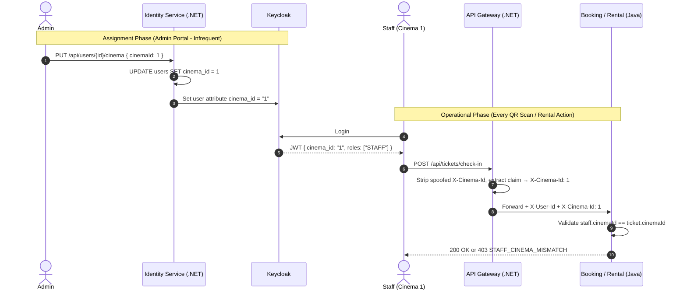

# Staff Cinema Scoping Implementation Plan

> **Status**: Ready for Implementation  
> **Scope**: Cinema-scoped staff authorization for ticket check-in and room rental approval/decline. No new roles introduced.  
> **Owner**: You — responsible for `identity-service`, `api-gateway`, `facility-service`, `payment-service`, `notification-service` (all .NET / C#), Keycloak config, and frontend.  
> **Colleague**: Responsible for all Spring Boot / Java services (`booking-service`, `catalog-service`, `showtime-service`, `analytics-service`, `recommendation-service`, `rental-service`).  
> **Related Docs**:
> - [multi_cinema_staff_and_room_rental_scope_impact.md](file:///c:/DoAn1/DA1-CinemaMS/cinema-booking-system/backend/localdocs/multi_cinema_staff_and_room_rental_scope_impact.md)
> - [keycloak_setup_guide.md](file:///c:/DoAn1/DA1-CinemaMS/cinema-booking-system/backend/services/identity-service/keycloak_setup_guide.md)

---

## 1. Design Decision Summary

### 1.1 Simplified Authorization Model (Final Decision)
No new roles. Existing `ADMIN`, `STAFF`, `CUSTOMER` remain unchanged.

| Role | Ticket Check-In | Room Rental Approve/Decline | Cinema Scope |
|---|---|---|---|
| **ADMIN** | ✅ All cinemas | ✅ All cinemas | Global (no restriction) |
| **STAFF** | ✅ Own cinema only | ✅ Own cinema only | Restricted to assigned `CinemaId` |
| **CUSTOMER** | ❌ | ❌ (Can submit rental requests) | N/A |

### 1.2 Data Model: `CinemaId` Column on `users` Table
- Each STAFF belongs to **exactly one cinema** — a nullable column is sufficient.
- 99% of customers having `CinemaId = NULL` is harmless (PostgreSQL NULL storage cost ≈ 0).
- If future requirements demand multi-cinema assignments, migration to a join table is trivial.

### 1.3 Zero-Hop Token Claims Architecture
Downstream Java services **never** call Identity Service at runtime to resolve cinema scope. Instead:
1. Admin assigns staff to a cinema via Identity Service API.
2. Identity Service persists to PostgreSQL **and** syncs `cinema_id` to Keycloak User Attribute.
3. Keycloak embeds `cinema_id` claim in JWT at login time.
4. API Gateway extracts the claim and forwards it as `X-Cinema-Id` header.
5. Java services read the header in-memory (0 ms latency).



---

## 2. Your Implementation Scope (.NET + Keycloak)

### 2.1 Identity Service — Domain Change

File: [User.cs](file:///c:/DoAn1/DA1-CinemaMS/cinema-booking-system/backend/services/identity-service/IdentityService.Domain/Entities/User.cs)

```diff
 public class User
 {
     public long Id { get; private set; }
     public string KeycloakId { get; private set; } = string.Empty;
     public string Email { get; private set; } = string.Empty;
     public string FullName { get; private set; } = string.Empty;
     public string? Phone { get; private set; }
     public Gender? Gender { get; private set; }
     public DateTime? DateOfBirth { get; private set; }
+    public long? CinemaId { get; private set; }
     public bool Active { get; private set; } = true;
     public DateTime CreatedAt { get; private set; } = DateTime.UtcNow;
     public DateTime? UpdatedAt { get; private set; }

+    public void AssignCinema(long? cinemaId)
+    {
+        CinemaId = cinemaId;
+        UpdatedAt = DateTime.UtcNow;
+    }
 }
```

### 2.2 Identity Service — EF Core Migration

```bash
cd cinema-booking-system/backend/services/identity-service
dotnet ef migrations add AddCinemaIdToUser --project IdentityService.Infrastructure --startup-project IdentityService.Presentation
```

### 2.3 Identity Service — Application Command

Create: `IdentityService.Application/Features/Users/Commands/AssignStaffCinemaCommand.cs`

```csharp
public record AssignStaffCinemaCommand(long UserId, long? CinemaId) : IRequest;

public class AssignStaffCinemaCommandValidator : AbstractValidator<AssignStaffCinemaCommand>
{
    public AssignStaffCinemaCommandValidator()
    {
        RuleFor(x => x.UserId).GreaterThan(0);
        When(x => x.CinemaId.HasValue, () =>
        {
            RuleFor(x => x.CinemaId!.Value).GreaterThan(0);
        });
    }
}

public class AssignStaffCinemaCommandHandler : IRequestHandler<AssignStaffCinemaCommand>
{
    private readonly IUserRepository _userRepository;
    private readonly IKeycloakAdminClient _keycloakAdmin;
    private readonly IUnitOfWork _unitOfWork;

    public AssignStaffCinemaCommandHandler(
        IUserRepository userRepository,
        IKeycloakAdminClient keycloakAdmin,
        IUnitOfWork unitOfWork)
    {
        _userRepository = userRepository;
        _keycloakAdmin = keycloakAdmin;
        _unitOfWork = unitOfWork;
    }

    public async Task Handle(AssignStaffCinemaCommand request, CancellationToken ct)
    {
        var user = await _userRepository.GetByIdAsync(request.UserId, ct)
            ?? throw new UserNotFoundException(request.UserId);

        // 1. Persist to local DB
        user.AssignCinema(request.CinemaId);
        await _unitOfWork.SaveChangesAsync(ct);

        // 2. Sync to Keycloak user attribute (so JWT carries cinema_id at login)
        var value = request.CinemaId?.ToString() ?? "";
        await _keycloakAdmin.SetUserAttributeAsync(user.KeycloakId, "cinema_id", value, ct);
    }
}
```

### 2.4 Identity Service — Controller Endpoint

File: [UsersController.cs](file:///c:/DoAn1/DA1-CinemaMS/cinema-booking-system/backend/services/identity-service/IdentityService.Presentation/Controllers/UsersController.cs)

```csharp
public record AssignCinemaRequest(long? CinemaId);

[HttpPut("{id}/cinema")]
[Authorize(Roles = "ADMIN")]
public async Task<IActionResult> AssignStaffCinema(long id, [FromBody] AssignCinemaRequest request)
{
    await _mediator.Send(new AssignStaffCinemaCommand(id, request.CinemaId));
    return NoContent();
}
```

### 2.5 Identity Service — Keycloak Admin Client Extension

Add to `IKeycloakAdminClient` interface and `KeycloakAdminClient` implementation:

```csharp
// Interface
Task SetUserAttributeAsync(string keycloakId, string attributeName, string attributeValue, CancellationToken ct);

// Implementation
public async Task SetUserAttributeAsync(string keycloakId, string attributeName, string attributeValue, CancellationToken ct)
{
    var user = await GetKeycloakUserAsync(keycloakId, ct);
    user.Attributes ??= new Dictionary<string, IEnumerable<string>>();
    user.Attributes[attributeName] = string.IsNullOrEmpty(attributeValue)
        ? Array.Empty<string>()
        : new[] { attributeValue };
    await UpdateKeycloakUserAsync(keycloakId, user, ct);
}
```

### 2.6 Keycloak — Protocol Mapper Configuration

In Keycloak Admin Console → Client Scopes → `roles` (or dedicated scope) → Mappers → Add mapper:

| Setting | Value |
|---|---|
| Mapper Type | User Attribute |
| Name | `cinema_id_mapper` |
| User Attribute | `cinema_id` |
| Token Claim Name | `cinema_id` |
| Claim JSON Type | `long` |
| Add to access token | `ON` |
| Add to ID token | `ON` |

> [!NOTE]
> No new realm roles are added. Only a user attribute and its token mapper.

### 2.7 API Gateway — Header Forwarding

File: [KeycloakUserIdResolutionMiddleware.cs](file:///c:/DoAn1/DA1-CinemaMS/cinema-booking-system/backend/services/api-gateway/ApiGateway/Middleware/KeycloakUserIdResolutionMiddleware.cs)

```diff
  // Strip any incoming spoofable headers
  context.Request.Headers.Remove("X-User-Id");
  context.Request.Headers.Remove("X-Keycloak-Id");
  context.Request.Headers.Remove("X-User-Roles");
  context.Request.Headers.Remove("X-User-Email");
+ context.Request.Headers.Remove("X-Cinema-Id");

  if (context.User.Identity?.IsAuthenticated == true)
  {
      var keycloakId = context.User.FindFirst(ClaimTypes.NameIdentifier)?.Value;
      // ... existing X-User-Id resolution ...

+     var cinemaIdClaim = context.User.FindFirst("cinema_id")?.Value;
+     if (!string.IsNullOrEmpty(cinemaIdClaim))
+     {
+         context.Request.Headers["X-Cinema-Id"] = cinemaIdClaim;
+     }
  }
```

---

## 3. Handoff Specification for Colleague (Java / Spring Boot Services)

> [!IMPORTANT]
> Share this section with your colleague. They need to implement the cinema scope checks in `booking-service` and `rental-service` (or `catalog-service`). All data they need arrives via the `X-Cinema-Id` header forwarded by the Gateway — **no HTTP calls to Identity Service**.

### 3.1 What the Gateway Provides
After your implementation, every authenticated request from a staff member will carry:

```
X-User-Id: 42
X-Cinema-Id: 1          ← NEW: staff's assigned cinema (null/absent for customers)
Authorization: Bearer <jwt>
```

### 3.2 Contract: Reading Cinema Scope in Java
Colleague should add a utility to `AuthenticatedUserIdResolver.java` (or equivalent):

```java
public Long currentCinemaId() {
    // Option 1: From JWT claim (if service decodes JWT directly)
    Authentication auth = SecurityContextHolder.getContext().getAuthentication();
    if (auth instanceof JwtAuthenticationToken jwtAuth) {
        Object claim = jwtAuth.getToken().getClaim("cinema_id");
        if (claim != null) {
            try { return Long.parseLong(String.valueOf(claim)); }
            catch (NumberFormatException ignored) {}
        }
    }
    // Option 2: From Gateway-forwarded header
    HttpServletRequest request = currentHttpRequest();
    if (request != null) {
        String header = request.getHeader("X-Cinema-Id");
        if (StringUtils.hasText(header)) {
            try { return Long.parseLong(header); }
            catch (NumberFormatException ignored) {}
        }
    }
    return null;
}
```

### 3.3 Contract: Ticket Check-In Cinema Guard (`booking-service`)
In `TicketServiceImpl.checkIn()` or `TicketController`:

```java
// ADMIN → bypass, allow all cinemas
// STAFF → must match cinema
if (!userIdResolver.hasAnyRole("ADMIN")) {
    Long staffCinemaId = userIdResolver.currentCinemaId();
    Long ticketCinemaId = resolveTicketCinemaId(ticket); // via showtime → room → cinemaId

    if (staffCinemaId == null) {
        throw 403 "STAFF_NO_CINEMA";
    }
    if (ticketCinemaId != null && !staffCinemaId.equals(ticketCinemaId)) {
        throw 403 "STAFF_CINEMA_MISMATCH";
    }
}
```

### 3.4 Contract: Room Rental Approval Guard (`rental-service`)
In the rental approve/decline endpoint:

```java
@PreAuthorize("hasAnyRole('STAFF', 'ADMIN')")
public ResponseEntity approve(@PathVariable Long rentalId) {
    RoomRentalRequest rental = findById(rentalId);

    if (!userIdResolver.hasAnyRole("ADMIN")) {
        Long staffCinemaId = userIdResolver.currentCinemaId();
        if (staffCinemaId == null || !staffCinemaId.equals(rental.getCinemaId())) {
            throw 403 "STAFF_CINEMA_MISMATCH";
        }
    }

    return rentalService.approve(rentalId);
}
```

---

## 4. Implementation Checklist

### Your Tasks (Phase 1 — .NET + Keycloak)
- [ ] Add `CinemaId` property and `AssignCinema()` to [User.cs](file:///c:/DoAn1/DA1-CinemaMS/cinema-booking-system/backend/services/identity-service/IdentityService.Domain/Entities/User.cs).
- [ ] Generate EF Core migration `AddCinemaIdToUser`.
- [ ] Add `SetUserAttributeAsync` to `IKeycloakAdminClient` and implementation.
- [ ] Create `AssignStaffCinemaCommand` (validator + handler with Keycloak sync).
- [ ] Add `PUT /api/users/{id}/cinema` endpoint to `UsersController.cs`.
- [ ] Write unit tests for `AssignStaffCinemaCommandHandler`.
- [ ] Configure `cinema_id` Protocol Mapper in Keycloak.
- [ ] Update `KeycloakUserIdResolutionMiddleware.cs` to strip and forward `X-Cinema-Id`.

### Colleague's Tasks (Phase 2 — Java / Spring Boot)
- [ ] Add `currentCinemaId()` utility to `AuthenticatedUserIdResolver.java` in `booking-service`.
- [ ] Add cinema scope check in `TicketServiceImpl.checkIn()`.
- [ ] Apply same pattern in `rental-service` for approve/decline endpoints.
- [ ] Write unit tests for cinema match/mismatch/admin-bypass scenarios.
