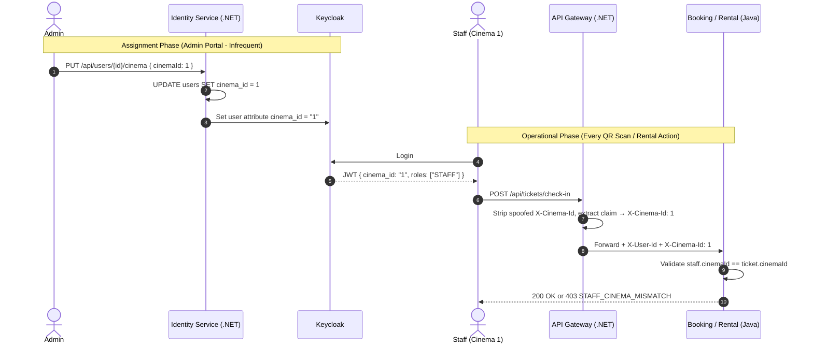

# Staff Cinema Scoping Implementation Plan

> **Status**: Ready for Implementation  
> **Scope**: Cinema-scoped staff authorization for ticket check-in and room rental approval/decline. No new roles introduced.  
> **Owner**: You — responsible for `identity-service`, `api-gateway`, `facility-service`, `payment-service`, `notification-service` (all .NET / C#), Keycloak config, and frontend.  
> **Colleague**: Responsible for all Spring Boot / Java services (`booking-service`, `catalog-service`, `showtime-service`, `analytics-service`, `recommendation-service`, `rental-service`).  
> **Related Docs**:
> - [multi_cinema_staff_and_room_rental_scope_impact.md](file:///c:/DoAn1/DA1-CinemaMS/cinema-booking-system/backend/localdocs/multi_cinema_staff_and_room_rental_scope_impact.md)
> - [keycloak_setup_guide.md](file:///c:/DoAn1/DA1-CinemaMS/cinema-booking-system/backend/services/identity-service/keycloak_setup_guide.md)

---

## 1. Design Decision Summary

### 1.1 Simplified Authorization Model (Final Decision)
No new roles. Existing `ADMIN`, `STAFF`, `CUSTOMER` remain unchanged.

| Role | Ticket Check-In | Room Rental Approve/Decline | Cinema Scope |
|---|---|---|---|
| **ADMIN** | ✅ All cinemas | ✅ All cinemas | Global (no restriction) |
| **STAFF** | ✅ Own cinema only | ✅ Own cinema only | Restricted to assigned `CinemaId` |
| **CUSTOMER** | ❌ | ❌ (Can submit rental requests) | N/A |

### 1.2 Data Model: `CinemaId` Column on `users` Table
- Each STAFF belongs to **exactly one cinema** — a nullable column is sufficient.
- 99% of customers having `CinemaId = NULL` is harmless (PostgreSQL NULL storage cost ≈ 0).
- If future requirements demand multi-cinema assignments, migration to a join table is trivial.

### 1.3 Zero-Hop Token Claims Architecture
Downstream Java services **never** call Identity Service at runtime to resolve cinema scope. Instead:
1. Admin assigns staff to a cinema via Identity Service API.
2. Identity Service persists to PostgreSQL **and** syncs `cinema_id` to Keycloak User Attribute.
3. Keycloak embeds `cinema_id` claim in JWT at login time.
4. API Gateway extracts the claim and forwards it as `X-Cinema-Id` header.
5. Java services read the header in-memory (0 ms latency).



---

## 2. Your Implementation Scope (.NET + Keycloak)

### 2.1 Identity Service — Domain Change

File: [User.cs](file:///c:/DoAn1/DA1-CinemaMS/cinema-booking-system/backend/services/identity-service/IdentityService.Domain/Entities/User.cs)

```diff
 public class User
 {
     public long Id { get; private set; }
     public string KeycloakId { get; private set; } = string.Empty;
     public string Email { get; private set; } = string.Empty;
     public string FullName { get; private set; } = string.Empty;
     public string? Phone { get; private set; }
     public Gender? Gender { get; private set; }
     public DateTime? DateOfBirth { get; private set; }
+    public long? CinemaId { get; private set; }
     public bool Active { get; private set; } = true;
     public DateTime CreatedAt { get; private set; } = DateTime.UtcNow;
     public DateTime? UpdatedAt { get; private set; }

+    public void AssignCinema(long? cinemaId)
+    {
+        CinemaId = cinemaId;
+        UpdatedAt = DateTime.UtcNow;
+    }
 }
```

### 2.2 Identity Service — EF Core Migration

```bash
cd cinema-booking-system/backend/services/identity-service
dotnet ef migrations add AddCinemaIdToUser --project IdentityService.Infrastructure --startup-project IdentityService.Presentation
```

### 2.3 Identity Service — Application Command

Create: `IdentityService.Application/Features/Users/Commands/AssignStaffCinemaCommand.cs`

```csharp
public record AssignStaffCinemaCommand(long UserId, long? CinemaId) : IRequest;

public class AssignStaffCinemaCommandValidator : AbstractValidator<AssignStaffCinemaCommand>
{
    public AssignStaffCinemaCommandValidator()
    {
        RuleFor(x => x.UserId).GreaterThan(0);
        When(x => x.CinemaId.HasValue, () =>
        {
            RuleFor(x => x.CinemaId!.Value).GreaterThan(0);
        });
    }
}

public class AssignStaffCinemaCommandHandler : IRequestHandler<AssignStaffCinemaCommand>
{
    private readonly IUserRepository _userRepository;
    private readonly IKeycloakAdminClient _keycloakAdmin;
    private readonly IUnitOfWork _unitOfWork;

    public AssignStaffCinemaCommandHandler(
        IUserRepository userRepository,
        IKeycloakAdminClient keycloakAdmin,
        IUnitOfWork unitOfWork)
    {
        _userRepository = userRepository;
        _keycloakAdmin = keycloakAdmin;
        _unitOfWork = unitOfWork;
    }

    public async Task Handle(AssignStaffCinemaCommand request, CancellationToken ct)
    {
        var user = await _userRepository.GetByIdAsync(request.UserId, ct)
            ?? throw new UserNotFoundException(request.UserId);

        // 1. Persist to local DB
        user.AssignCinema(request.CinemaId);
        await _unitOfWork.SaveChangesAsync(ct);

        // 2. Sync to Keycloak user attribute (so JWT carries cinema_id at login)
        var value = request.CinemaId?.ToString() ?? "";
        await _keycloakAdmin.SetUserAttributeAsync(user.KeycloakId, "cinema_id", value, ct);
    }
}
```

### 2.4 Identity Service — Controller Endpoint

File: [UsersController.cs](file:///c:/DoAn1/DA1-CinemaMS/cinema-booking-system/backend/services/identity-service/IdentityService.Presentation/Controllers/UsersController.cs)

```csharp
public record AssignCinemaRequest(long? CinemaId);

[HttpPut("{id}/cinema")]
[Authorize(Roles = "ADMIN")]
public async Task<IActionResult> AssignStaffCinema(long id, [FromBody] AssignCinemaRequest request)
{
    await _mediator.Send(new AssignStaffCinemaCommand(id, request.CinemaId));
    return NoContent();
}
```

### 2.5 Identity Service — Keycloak Admin Client Extension

Add to `IKeycloakAdminClient` interface and `KeycloakAdminClient` implementation:

```csharp
// Interface
Task SetUserAttributeAsync(string keycloakId, string attributeName, string attributeValue, CancellationToken ct);

// Implementation
public async Task SetUserAttributeAsync(string keycloakId, string attributeName, string attributeValue, CancellationToken ct)
{
    var user = await GetKeycloakUserAsync(keycloakId, ct);
    user.Attributes ??= new Dictionary<string, IEnumerable<string>>();
    user.Attributes[attributeName] = string.IsNullOrEmpty(attributeValue)
        ? Array.Empty<string>()
        : new[] { attributeValue };
    await UpdateKeycloakUserAsync(keycloakId, user, ct);
}
```

### 2.6 Keycloak — Protocol Mapper Configuration

In Keycloak Admin Console → Client Scopes → `roles` (or dedicated scope) → Mappers → Add mapper:

| Setting | Value |
|---|---|
| Mapper Type | User Attribute |
| Name | `cinema_id_mapper` |
| User Attribute | `cinema_id` |
| Token Claim Name | `cinema_id` |
| Claim JSON Type | `long` |
| Add to access token | `ON` |
| Add to ID token | `ON` |

> [!NOTE]
> No new realm roles are added. Only a user attribute and its token mapper.

### 2.7 API Gateway — Header Forwarding

File: [KeycloakUserIdResolutionMiddleware.cs](file:///c:/DoAn1/DA1-CinemaMS/cinema-booking-system/backend/services/api-gateway/ApiGateway/Middleware/KeycloakUserIdResolutionMiddleware.cs)

```diff
  // Strip any incoming spoofable headers
  context.Request.Headers.Remove("X-User-Id");
  context.Request.Headers.Remove("X-Keycloak-Id");
  context.Request.Headers.Remove("X-User-Roles");
  context.Request.Headers.Remove("X-User-Email");
+ context.Request.Headers.Remove("X-Cinema-Id");

  if (context.User.Identity?.IsAuthenticated == true)
  {
      var keycloakId = context.User.FindFirst(ClaimTypes.NameIdentifier)?.Value;
      // ... existing X-User-Id resolution ...

+     var cinemaIdClaim = context.User.FindFirst("cinema_id")?.Value;
+     if (!string.IsNullOrEmpty(cinemaIdClaim))
+     {
+         context.Request.Headers["X-Cinema-Id"] = cinemaIdClaim;
+     }
  }
```

---

## 3. Handoff Specification for Colleague (Java / Spring Boot Services)

> [!IMPORTANT]
> Share this section with your colleague. They need to update [`rental-service`](file:///c:/DoAn1/DA1-CinemaMS/cinema-booking-system/backend/services/rental-service) and [`booking-service`](file:///c:/DoAn1/DA1-CinemaMS/cinema-booking-system/backend/services/booking-service) in the `feature/room-rental` branch.
> All cinema-scoping data arrives via the **`X-Cinema-Id`** header forwarded by the API Gateway — **no HTTP calls to Identity Service**.

---

### 3.1 Architectural Shift: Obsoleting the `MANAGER` Role

In the initial draft of the base branch (`feature/room-rental`), `rental-service` was designed around a separate `MANAGER` role, multi-cinema lists (`List<Long> cinemaIds`), and an internal HTTP round-trip (`/internal/users/{id}/cinema-scope`). 

**All of these concepts are now OBSOLETE and must be refactored:**

| Concept | Base Branch (`feature/room-rental`) | Final Architecture | Reason & Action Required |
|---|---|---|---|
| **Role Name** | `MANAGER` | `STAFF` (with `cinema_id`) | Keycloak only defines `ADMIN`, `STAFF`, and `CUSTOMER`. No `MANAGER` role exists. Cinema branch management is performed by `STAFF` assigned to that cinema (or `ADMIN`). |
| **Scope Cardinality** | `List<Long> cinemaIds` (multi-cinema) | `Long cinemaId` (single cinema) | A staff member is assigned to exactly one cinema branch at any time. `cinemaId` is a single nullable `Long`. |
| **Data Resolution** | Runtime HTTP Call: `scopes.scopeOf(userId)` -> `GET /internal/users/{id}/cinema-scope` | **Zero-hop header**: Gateway forwards `X-Cinema-Id: <id>` | Calling Identity Service at runtime adds network latency and failure coupling. Header forwarding resolves cinema scope in 0 ms. |
| **Model Helper** | `actor.managerOf(cinemaId)` | `actor.canManage(cinemaId)` | Method checks `admin()` OR `staffOf(cinemaId)`. |
| **Token Claims Support** | `APPLICATION_ROLES` had `MANAGER` | `APPLICATION_ROLES` has `ADMIN`, `STAFF`, `CUSTOMER` | Remove `MANAGER` from [KeycloakJwtSupport.java](file:///c:/DoAn1/DA1-CinemaMS/cinema-booking-system/backend/services/rental-service/src/main/java/com/uit/cinema/rental/config/KeycloakJwtSupport.java). |

---

### 3.2 Gateway & Keycloak Request Contract

Every request arriving at downstream Java services via the API Gateway carries the following headers:

```http
X-User-Id: 42
X-Cinema-Id: 1              <-- Staff's assigned cinema ID (absent/null for customers or unassigned staff)
Authorization: Bearer <jwt>  <-- JWT containing claims "cinema_id": 1, roles: ["STAFF"]
```

---

### 3.3 Step-by-Step Refactoring Guide for `rental-service`

#### Step 1: Remove HTTP Scope Client
File: [`RentalClients.java`](file:///c:/DoAn1/DA1-CinemaMS/cinema-booking-system/backend/services/rental-service/src/main/java/com/uit/cinema/rental/client/RentalClients.java)
- Delete:
  ```java
  // DELETE THIS RECORD:
  record CinemaScope(String realmRole, List<Long> cinemaIds) {}

  // DELETE THIS INTERFACE:
  interface CinemaScopeClient {
      CinemaScope scopeOf(Long userId);
  }
  ```

File: [`HttpRentalClients.java`](file:///c:/DoAn1/DA1-CinemaMS/cinema-booking-system/backend/services/rental-service/src/main/java/com/uit/cinema/rental/client/HttpRentalClients.java)
- Remove `RentalClients.CinemaScopeClient` from class `implements` declaration.
- Delete the `scopeOf(Long userId)` method:
  ```java
  // DELETE THIS ENTIRE METHOD:
  @Override
  public RentalClients.CinemaScope scopeOf(Long userId) { ... }
  ```
- Delete the inner class `ScopePayload`:
  ```java
  // DELETE THIS CLASS:
  private static final class ScopePayload {
      public String realmRole;
      public List<Long> cinemaIds;
  }
  ```

#### Step 2: Update `RentalModels.Actor`
File: [`RentalModels.java`](file:///c:/DoAn1/DA1-CinemaMS/cinema-booking-system/backend/services/rental-service/src/main/java/com/uit/cinema/rental/service/RentalModels.java)
Replace the `Actor` record with single-cinema `STAFF`:

```java
public record Actor(Long userId, String realmRole, Long cinemaId) {
    public boolean admin() {
        return "ADMIN".equalsIgnoreCase(realmRole);
    }

    public boolean staff() {
        return "STAFF".equalsIgnoreCase(realmRole);
    }

    public boolean staffOf(Long targetCinemaId) {
        return staff() && cinemaId != null && cinemaId.equals(targetCinemaId);
    }

    public boolean canManage(Long targetCinemaId) {
        return admin() || staffOf(targetCinemaId);
    }
}
```

#### Step 3: Update `KeycloakJwtSupport.java`
File: [`KeycloakJwtSupport.java`](file:///c:/DoAn1/DA1-CinemaMS/cinema-booking-system/backend/services/rental-service/src/main/java/com/uit/cinema/rental/config/KeycloakJwtSupport.java)
Remove `"MANAGER"` from the application roles set:

```diff
- private static final Set<String> APPLICATION_ROLES = Set.of("ADMIN", "MANAGER", "STAFF", "CUSTOMER");
+ private static final Set<String> APPLICATION_ROLES = Set.of("ADMIN", "STAFF", "CUSTOMER");
```

#### Step 4: Refactor `RentalActorResolver.java`
File: [`RentalActorResolver.java`](file:///c:/DoAn1/DA1-CinemaMS/cinema-booking-system/backend/services/rental-service/src/main/java/com/uit/cinema/rental/security/RentalActorResolver.java)
Remove the `CinemaScopeClient` dependency. Read `cinemaId` from the `X-Cinema-Id` header (with fallback to the JWT `cinema_id` claim):

```java
package com.uit.cinema.rental.security;

import com.uit.cinema.core.exception.CustomException;
import com.uit.cinema.rental.service.RentalModels;
import jakarta.servlet.http.HttpServletRequest;
import org.springframework.beans.factory.annotation.Value;
import org.springframework.http.HttpStatus;
import org.springframework.security.core.Authentication;
import org.springframework.security.core.GrantedAuthority;
import org.springframework.security.core.context.SecurityContextHolder;
import org.springframework.security.oauth2.server.resource.authentication.JwtAuthenticationToken;
import org.springframework.stereotype.Component;
import org.springframework.web.context.request.RequestContextHolder;
import org.springframework.web.context.request.ServletRequestAttributes;

import java.math.BigDecimal;

@Component
public class RentalActorResolver {

    private final boolean jwtEnabled;

    public RentalActorResolver(@Value("${cinema.security.jwt.enabled:false}") boolean jwtEnabled) {
        this.jwtEnabled = jwtEnabled;
    }

    public Long userId(Long requestedUserId) {
        Long headerUserId = headerUserId();
        if (headerUserId != null) {
            if (requestedUserId != null && !requestedUserId.equals(headerUserId)) {
                throw new CustomException("Requested user does not match the authenticated user", HttpStatus.FORBIDDEN, "USER_ID_MISMATCH");
            }
            return headerUserId;
        }
        if (!jwtEnabled) {
            if (requestedUserId == null || requestedUserId <= 0) {
                throw new CustomException("User is required", HttpStatus.BAD_REQUEST, "USER_REQUIRED");
            }
            return requestedUserId;
        }
        Authentication authentication = SecurityContextHolder.getContext().getAuthentication();
        if (!(authentication instanceof JwtAuthenticationToken jwt) || !authentication.isAuthenticated()) {
            throw new CustomException("Authentication is required", HttpStatus.UNAUTHORIZED, "AUTHENTICATION_REQUIRED");
        }
        Object claim = jwt.getToken().getClaim("user_id");
        try {
            long userId = new BigDecimal(String.valueOf(claim)).longValueExact();
            if (userId <= 0) {
                throw new ArithmeticException("user_id");
            }
            if (requestedUserId != null && requestedUserId != userId) {
                throw new CustomException("Requested user does not match the authenticated user", HttpStatus.FORBIDDEN, "USER_ID_MISMATCH");
            }
            return userId;
        } catch (ArithmeticException | NumberFormatException ex) {
            throw new CustomException("Authenticated user profile mapping is not available", HttpStatus.SERVICE_UNAVAILABLE, "USER_ID_MAPPING_UNAVAILABLE");
        }
    }

    private Long headerUserId() {
        if (!(RequestContextHolder.getRequestAttributes() instanceof ServletRequestAttributes attributes)) {
            return null;
        }
        HttpServletRequest request = attributes.getRequest();
        String raw = request.getHeader("X-User-Id");
        if (raw == null || raw.isBlank()) {
            return null;
        }
        try {
            long userId = Long.parseLong(raw.trim());
            if (userId <= 0) {
                throw new NumberFormatException("user id");
            }
            return userId;
        } catch (NumberFormatException ex) {
            throw new CustomException("User is required", HttpStatus.BAD_REQUEST, "USER_REQUIRED");
        }
    }

    private Long headerCinemaId() {
        if (!(RequestContextHolder.getRequestAttributes() instanceof ServletRequestAttributes attributes)) {
            return null;
        }
        String raw = attributes.getRequest().getHeader("X-Cinema-Id");
        if (raw == null || raw.isBlank()) {
            return null;
        }
        try {
            return Long.parseLong(raw.trim());
        } catch (NumberFormatException ex) {
            return null;
        }
    }

    private Long jwtCinemaId() {
        Authentication authentication = SecurityContextHolder.getContext().getAuthentication();
        if (authentication instanceof JwtAuthenticationToken jwt && authentication.isAuthenticated()) {
            Object claim = jwt.getToken().getClaim("cinema_id");
            if (claim != null) {
                try {
                    return new BigDecimal(String.valueOf(claim)).longValueExact();
                } catch (Exception ignored) {
                }
            }
        }
        return null;
    }

    private String resolveRealmRole() {
        Authentication authentication = SecurityContextHolder.getContext().getAuthentication();
        if (authentication == null || !authentication.isAuthenticated()) {
            return null;
        }
        for (GrantedAuthority authority : authentication.getAuthorities()) {
            String auth = authority.getAuthority();
            if (auth.startsWith("ROLE_")) {
                return auth.substring(5);
            }
        }
        return null;
    }

    public RentalModels.Actor actor(Long requestedUserId) {
        Long userId = userId(requestedUserId);
        String role = resolveRealmRole();
        Long cinemaId = headerCinemaId();
        if (cinemaId == null) {
            cinemaId = jwtCinemaId();
        }
        return new RentalModels.Actor(userId, role, cinemaId);
    }
}
```

#### Step 5: Update Guard Logic in `RentalService.java`
File: [`RentalService.java`](file:///c:/DoAn1/DA1-CinemaMS/cinema-booking-system/backend/services/rental-service/src/main/java/com/uit/cinema/rental/service/RentalService.java)

1. **Replace `requireManager` with `requireStaffOrAdmin`**:
   ```java
   private void requireStaffOrAdmin(RentalModels.Actor actor, Long cinemaId) {
       if (actor == null || !actor.canManage(cinemaId)) {
           throw new CustomException(
               "Forbidden: You do not have permission to manage rentals for cinema " + cinemaId,
               HttpStatus.FORBIDDEN,
               "STAFF_CINEMA_MISMATCH"
           );
       }
   }
   ```

2. **Update `requireReader`**:
   ```java
   private void requireReader(RentalModels.Actor actor) {
       if (actor == null || !(actor.admin() || actor.staff())) {
           throw forbidden();
       }
   }
   ```

3. **Update `inScope`**:
   ```java
   private boolean inScope(RentalModels.Actor actor, Long cinemaId) {
       return actor.canManage(cinemaId);
   }
   ```

4. **Update Action Endpoints**:
   - **`approve(Long id, RentalModels.Actor actor)`**:
     ```java
     requireStaffOrAdmin(actor, rental.getCinemaId());
     ```
   - **`reject(Long id, String reason, RentalModels.Actor actor)`**:
     ```java
     requireStaffOrAdmin(actor, rental.getCinemaId());
     ```
   - **`pay(Long id, String paymentMethod, RentalModels.Actor actor)`**:
     ```java
     if ("CASH".equals(method)) {
         if (!actor.canManage(rental.getCinemaId())) {
             throw new CustomException("Cash payment can only be confirmed at the cinema counter", HttpStatus.FORBIDDEN, "CASH_COUNTER_ONLY");
         }
         return confirmPayment(rental, method);
     }
     ```
   - **`cancel(Long id, RentalModels.Actor actor)`**:
     ```java
     boolean owner = actor.userId().equals(rental.getUserId());
     boolean manager = actor.canManage(rental.getCinemaId());
     ```
   - **`completeRefund(Long id, RentalModels.Actor actor)`**:
     ```java
     requireStaffOrAdmin(actor, rental.getCinemaId());
     ```
   - **`setRate(Long roomId, BigDecimal pricePerHour, RentalModels.Actor actor)`**:
     ```java
     FacilityRoomPayload room = rooms.room(roomId);
     requireStaffOrAdmin(actor, room.cinemaId);
     ```
   - **`report(RentalModels.Actor actor, LocalDateTime from, LocalDateTime to)`**:
     ```java
     if (actor == null || !(actor.admin() || actor.staff())) {
         throw forbidden();
     }
     Long cinemaFilter = actor.admin() ? null : actor.cinemaId();
     List<RoomRental> rows = filtered(actor, cinemaFilter, null, null, from, to);
     ```
   - **`search(RentalModels.Actor actor, Long cinemaId, Long roomId, RentalStatus status, ...)`**:
     ```java
     Long targetCinema = actor.admin() ? cinemaId : actor.cinemaId();
     // Staff cannot query another cinema
     if (actor.staff() && cinemaId != null && !cinemaId.equals(actor.cinemaId())) {
         return List.of();
     }
     ```

#### Step 6: Update Unit Tests in `RentalServiceTest.java`
File: [`RentalServiceTest.java`](file:///c:/DoAn1/DA1-CinemaMS/cinema-booking-system/backend/services/rental-service/src/test/java/com/uit/cinema/rental/service/RentalServiceTest.java)

Update mock actors and method names:
```java
// 1. Rename and update approve forbidden test:
@Test
void approve_staffOfAnotherCinemaIsForbidden() {
    assertThrows(CustomException.class, () ->
        service.approve(10L, new RentalModels.Actor(4L, "STAFF", 9L)));
}

// 2. Rename and update approve success test:
@Test
void approve_staffOfCinemaMovesToPayment() {
    RentalModels.RentalView view = service.approve(10L, new RentalModels.Actor(4L, "STAFF", 3L));
    assertThat(view.status()).isEqualTo(RentalStatus.AWAITING_PAYMENT);
}

// 3. Rename and update cash payment test:
@Test
void pay_staffCashConfirmsAfterShowtimeCheck() {
    RentalModels.RentalView view = service.pay(10L, "CASH", new RentalModels.Actor(4L, "STAFF", 3L));
    assertThat(view.status()).isEqualTo(RentalStatus.CONFIRMED);
}

// 4. Rename and update cancel test:
@Test
void cancel_staffBeforeStartRecordsPendingRefund() {
    RentalModels.RentalView view = service.cancel(10L, new RentalModels.Actor(4L, "STAFF", 3L));
    assertThat(view.status()).isEqualTo(RentalStatus.CANCELLED);
}
```

---

### 3.4 Contract & Implementation Guide for `booking-service`

#### Step 1: Add `currentCinemaId()` to `AuthenticatedUserIdResolver.java`
File: [`AuthenticatedUserIdResolver.java`](file:///c:/DoAn1/DA1-CinemaMS/cinema-booking-system/backend/services/booking-service/src/main/java/com/uit/cinema/booking/security/AuthenticatedUserIdResolver.java)

Add cinema resolution logic:
```java
public Long currentCinemaId() {
    // 1. Try X-Cinema-Id header forwarded by API Gateway
    if (RequestContextHolder.getRequestAttributes() instanceof ServletRequestAttributes attributes) {
        String raw = attributes.getRequest().getHeader("X-Cinema-Id");
        if (raw != null && !raw.isBlank()) {
            try {
                return Long.parseLong(raw.trim());
            } catch (NumberFormatException ignored) {
            }
        }
    }

    // 2. Fallback: extract cinema_id claim from JWT token
    Authentication authentication = SecurityContextHolder.getContext().getAuthentication();
    if (authentication instanceof JwtAuthenticationToken jwt && authentication.isAuthenticated()) {
        Object claim = jwt.getToken().getClaim("cinema_id");
        if (claim != null) {
            try {
                return new BigDecimal(String.valueOf(claim)).longValueExact();
            } catch (Exception ignored) {
            }
        }
    }
    return null;
}
```

#### Step 2: Enforce Ticket Check-In Scope in `TicketServiceImpl.java`
File: [`TicketServiceImpl.java`](file:///c:/DoAn1/DA1-CinemaMS/cinema-booking-system/backend/services/booking-service/src/main/java/com/uit/cinema/booking/service/impl/TicketServiceImpl.java)

When checking in tickets (`checkIn(String ticketCode)`):
```java
// ADMIN -> Global access (bypass cinema check)
// STAFF -> Must match assigned CinemaId
if (!userIdResolver.hasAnyRole("ADMIN")) {
    Long staffCinemaId = userIdResolver.currentCinemaId();
    if (staffCinemaId == null) {
        throw new CustomException("Staff has no assigned cinema", HttpStatus.FORBIDDEN, "STAFF_NO_CINEMA");
    }

    Long ticketCinemaId = resolveTicketCinemaId(ticket);
    if (ticketCinemaId != null && !staffCinemaId.equals(ticketCinemaId)) {
        throw new CustomException(
            "Staff cannot check in tickets for another cinema",
            HttpStatus.FORBIDDEN,
            "STAFF_CINEMA_MISMATCH"
        );
    }
}
```

---

## 4. Implementation Checklist

### Phase 1: .NET Services & Keycloak (COMPLETED)
- [x] Add `CinemaId` property and `AssignCinema()` to [User.cs](file:///c:/DoAn1/DA1-CinemaMS/cinema-booking-system/backend/services/identity-service/IdentityService.Domain/Entities/User.cs).
- [x] Generate and apply EF Core migration `20261025063351_AddCinemaIdToUser`.
- [x] Add `SetUserAttributeAsync` to `IKeycloakAdminClient` and `KeycloakAdminClient`.
- [x] Create `AssignStaffCinemaCommand` (validator + handler with Keycloak attribute synchronization).
- [x] Add `PUT /api/users/{id}/cinema` endpoint to `UsersController.cs` (`[Authorize(Roles = "admin,ADMIN")]`).
- [x] Write and verify unit tests in `AssignStaffCinemaCommandHandlerTests.cs` (all 102 tests pass).
- [x] Configure `cinema_id` user profile attribute & protocol mapper in Keycloak `cinema-booking` realm.
- [x] Update `KeycloakUserIdResolutionMiddleware.cs` in `ApiGateway` to extract JWT `cinema_id` and forward `X-Cinema-Id`.
- [x] Build and integrate frontend **Cinema Assignment (Staff)** tab under `/admin/permissions`.

### Phase 2: Colleague's Tasks (Spring Boot / Java)
- [ ] **`rental-service`**: Remove `CinemaScopeClient` and HTTP call to `/internal/users/{id}/cinema-scope` in `RentalClients.java` and `HttpRentalClients.java`.
- [ ] **`rental-service`**: Update `KeycloakJwtSupport.java` to remove `MANAGER` from `APPLICATION_ROLES`.
- [ ] **`rental-service`**: Update `RentalModels.Actor` to use `Long cinemaId` and role `STAFF` (remove `MANAGER` methods, add `canManage`).
- [ ] **`rental-service`**: Update `RentalActorResolver` to read `X-Cinema-Id` header (and fallback to JWT `cinema_id` claim).
- [ ] **`rental-service`**: Replace `requireManager()` with `requireStaffOrAdmin()` across `approve`, `reject`, `cancel`, `pay`, `completeRefund`, `setRate`.
- [ ] **`rental-service`**: Update `RentalServiceTest` mocks from `"MANAGER"` to `"STAFF"`.
- [ ] **`booking-service`**: Add `currentCinemaId()` resolver to `AuthenticatedUserIdResolver.java`.
- [ ] **`booking-service`**: Add cinema match validation in `TicketServiceImpl.checkIn()`.
- [ ] **`booking-service`**: Write unit tests for ticket check-in cinema match/mismatch/admin-bypass.

