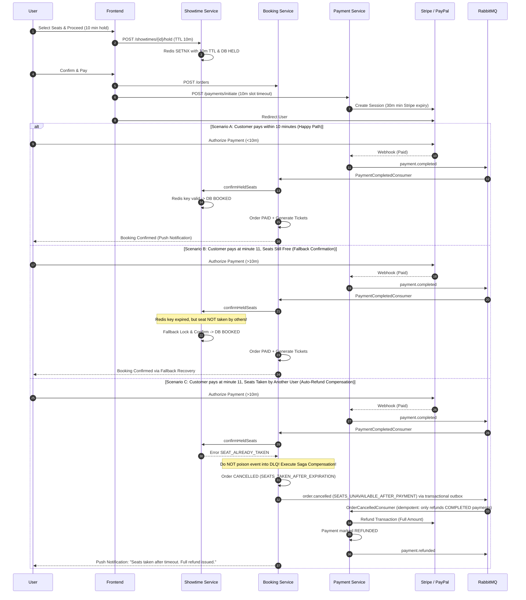

# Seat Hold TTL Alignment, Zombie Hold Prevention & Fallback Confirmation Fix Plan

> **Document Path**: `cinema-booking-system/docs/seat_hold_ttl_alignment_and_zombie_hold_fix_plan.md`  
> **Target Branch**: `fix/payment-flow-seat-retry-compensation`  
> **Related Architecture Docs**: [`booking_saga_flow.md`](file:///c:/DoAn1/DA1-CinemaMS/cinema-booking-system/docs/booking_saga_flow.md), [`payment_flow_retry_and_compensation_plan.md`](file:///c:/DoAn1/DA1-CinemaMS/cinema-booking-system/docs/payment_flow_retry_and_compensation_plan.md)  
> **Status**: Implemented (Phase 5 DLQ redrive intentionally skipped — university project, not production)  

---

## 1. Executive Summary & Root Cause Audit

An in-depth codebase audit revealed 4 interconnected architectural flaws that cause seat hold deadlocks, payment loss, and dead-letter queue poisoning:

```
                  ┌─────────────────────── 10m: Redis TTL expires ────────────────────────┐
                  │                                                                       ▼
Showtime (Redis)  │ [======== 10m HOLD ========]                                      [KEY GONE]
Showtime (DB)     │ [======== HELD status (NO TTL, never cleaned up) ==================== ZOMBIE HELD ]
Payment Service   │ [================ 15m Slot Timeout ===============]
Gateway (Stripe)  │ [============================ 24h Default Session =============================]
Frontend          │ [======== 10m UI Timer ======] (User is on PayPal/Stripe tab, timer unmounted)
                  │
                  └────── Minute 10 to 15: The Danger Window (Payment succeeds, seats fail) ──────┘
```

### Flaw 1: 5-Minute Asymmetric Timeout Window (10m Canonical Business Rule vs 15m in Payment Service)
- **`showtime-service` *(Source of Truth — 10m)***: [SeatHoldPolicy.java:L13](file:///c:/DoAn1/DA1-CinemaMS/cinema-booking-system/backend/services/showtime-service/src/main/java/com/uit/cinema/showtime/service/SeatHoldPolicy.java#L13) defines `HOLD_TTL = Duration.ofMinutes(10)` per the original business rule.
- **`frontend` *(Already in Sync — 10m)***: [Booking.tsx:L16](file:///c:/DoAn1/DA1-CinemaMS/cinema-booking-system/frontend/src/pages/portal/Booking.tsx#L16), [useSeatSelection.ts:L109,L136](file:///c:/DoAn1/DA1-CinemaMS/cinema-booking-system/frontend/src/hooks/useSeatSelection.ts#L109-L136), and [HoldTimer.tsx:L32](file:///c:/DoAn1/DA1-CinemaMS/cinema-booking-system/frontend/src/components/portal/HoldTimer.tsx#L32) all enforce a 10-minute (`600s`) hold window.
- **`payment-service` *(Out of Sync — 15m)***: [PaymentSlotExpirationWorker.cs:L36-L40](file:///c:/DoAn1/DA1-CinemaMS/cinema-booking-system/backend/services/payment-service/PaymentService.Infrastructure/BackgroundJobs/PaymentSlotExpirationWorker.cs#L36-L40) drifted from the business rule and defaults to `SlotTimeoutMinutes = 15`.
- **`booking-service` *(Indirectly Out of Sync — 15m)***: Relies entirely on `order.expired` emitted by `payment-service` (15m instead of 10m).
- **Gateways**: Stripe checkout sessions default to **24 hours**; PayPal orders default to **3 hours**.
- **Impact**: Because `payment-service` keeps the payment slot alive for 15 minutes while `showtime-service` expires the Redis seat hold at 10 minutes, any customer paying between minute 10 and minute 15 succeeds on the payment gateway after their Redis seat hold has already disappeared.

### Flaw 2: The PostgreSQL "Zombie Hold" Bug
- When 10 minutes elapse, Redis deletes the key `seat:hold:{showtimeId}:{seatId}`.
- In PostgreSQL `showtime_seats`, the row `status` remains `HELD` indefinitely because there is no background cleaner or Redis keyspace expiration listener.
- In [ShowtimeServiceImpl.java:L340](file:///c:/DoAn1/DA1-CinemaMS/cinema-booking-system/backend/services/showtime-service/src/main/java/com/uit/cinema/showtime/service/Impl/ShowtimeServiceImpl.java#L340):
  ```java
  if (status == ShowtimeSeat.SeatStatus.HELD || (holdTtlSeconds != null && holdTtlSeconds > 0)) {
      return "holding";
  }
  ```
  Because `status == HELD`, it returns `"holding"` to all users even though the hold is expired!
- In [SeatLockingServiceImpl.java:L57](file:///c:/DoAn1/DA1-CinemaMS/cinema-booking-system/backend/services/showtime-service/src/main/java/com/uit/cinema/showtime/service/Impl/SeatLockingServiceImpl.java#L57):
  ```java
  if (seat.getStatus() != ShowtimeSeat.SeatStatus.AVAILABLE) {
      redisTemplate.delete(lockKey);
      throw new CustomException("Ghế không khả dụng", HttpStatus.CONFLICT, "SEAT_NOT_AVAILABLE");
  }
  ```
  New customers cannot hold the seat because `status != AVAILABLE`.
- **Impact**: Abandoned seats are permanently locked in a "zombie" state until a database patch or service restart.

### Flaw 3: Inflexible Seat Confirmation (No Fallback)
- In [SeatReservationServiceImpl.java:L80-L84](file:///c:/DoAn1/DA1-CinemaMS/cinema-booking-system/backend/services/showtime-service/src/main/java/com/uit/cinema/showtime/service/SeatReservationServiceImpl.java#L80-L84), `confirmHeldSeats` demands an active Redis hold key matching `userId`.
- If the Redis key expired at minute 10, but **nobody else took or booked the seat** (the seat is vacant), it throws `HttpStatus.CONFLICT` (`SEAT_HOLD_OWNER_MISMATCH`) instead of safely locking and confirming the paid seat.

### Flaw 4: Missing Saga Compensation & DLQ Poisoning
- When `confirmHeldSeats` throws `HttpStatus.CONFLICT`, [PaymentEventProcessor.java:L119](file:///c:/DoAn1/DA1-CinemaMS/cinema-booking-system/backend/services/booking-service/src/main/java/com/uit/cinema/booking/messaging/PaymentEventProcessor.java#L119) classifies it as `poison` and dumps the `payment.completed` event into `booking.payment.completed.v1.dlq`.
- `booking-service` rolls back, the order remains `PENDING`, no tickets are issued, and no refund event is sent to `payment-service`. The customer is charged without receiving tickets or money back.

---

## 2. Target Architecture & Workflow



---

## 3. Implementation Steps

### Phase 1: Timeout Synchronization (10 Minutes Across All Services — Original Business Rule)

Taking `showtime-service` (`10 minutes`) as the canonical source of truth:

1. **`payment-service` *(Out of Sync: 15m → 10m)*:**
   - In [`PaymentSlotExpirationWorker.cs:L36`](file:///c:/DoAn1/DA1-CinemaMS/cinema-booking-system/backend/services/payment-service/PaymentService.Infrastructure/BackgroundJobs/PaymentSlotExpirationWorker.cs#L36), change the default slot timeout from `15` to `10`:
     ```csharp
     var intervalSeconds = configuration.GetValue("Payment:ExpirationCheckIntervalSeconds", 60);
     var timeoutMinutes = configuration.GetValue("Payment:SlotTimeoutMinutes", 10);
     ```
   - In [`PaymentService.Presentation/appsettings.json`](file:///c:/DoAn1/DA1-CinemaMS/cinema-booking-system/backend/services/payment-service/PaymentService.Presentation/appsettings.json), explicitly define the 10-minute policy:
     ```json
     "Payment": {
       "SlotTimeoutMinutes": 10,
       "ExpirationCheckIntervalSeconds": 60
     }
     ```
   - In [`PaymentSlotExpirationWorkerTests.cs:L51,L114-L134`](file:///c:/DoAn1/DA1-CinemaMS/cinema-booking-system/backend/services/payment-service/PaymentService.Test/Unit/BackgroundJobs/PaymentSlotExpirationWorkerTests.cs#L51), update the test configuration and cutoff assertion from `15` minutes to `10` minutes (`ProcessExpiredSlotsAsync_ShouldUseCutoff10MinutesAgo`).
2. **`showtime-service` & `frontend` *(Already at 10m — Verify & Keep)*:**
   - [`SeatHoldPolicy.java:L13`](file:///c:/DoAn1/DA1-CinemaMS/cinema-booking-system/backend/services/showtime-service/src/main/java/com/uit/cinema/showtime/service/SeatHoldPolicy.java#L13) is already `Duration.ofMinutes(10)`. (Optionally expose `cinema.seat-hold.ttl-minutes: ${SEAT_HOLD_TTL_MINUTES:10}` in `application.yml`).
   - [`Booking.tsx:L16`](file:///c:/DoAn1/DA1-CinemaMS/cinema-booking-system/frontend/src/pages/portal/Booking.tsx#L16) (`PRE_HOLD_DURATION = 10 * 60`), [`useSeatSelection.ts:L109,L136`](file:///c:/DoAn1/DA1-CinemaMS/cinema-booking-system/frontend/src/hooks/useSeatSelection.ts#L109-L136) (`10 * 60 * 1000`), and [`HoldTimer.tsx:L32`](file:///c:/DoAn1/DA1-CinemaMS/cinema-booking-system/frontend/src/components/portal/HoldTimer.tsx#L32) (`totalSeconds = 10 * 60`) are already aligned to 10 minutes — **no changes required**.
3. **`booking-service` *(Automatically Aligned via `payment-service`)*:**
   - Once `payment-service` publishes `PaymentSlotExpired` / `order.expired` at 10 minutes, `booking-service` (`PaymentOrderExpiredConsumer.java`) will automatically expire abandoned `PENDING` orders at the 10-minute mark.
4. **Gateway Session Expiry:**
   - In [`StripeGateway.cs:L65`](file:///c:/DoAn1/DA1-CinemaMS/cinema-booking-system/backend/services/payment-service/PaymentService.Infrastructure/Gateways/StripeGateway.cs#L65):
     Pass `ExpiresAt = DateTimeOffset.UtcNow.AddMinutes(30).ToUnixTimeSeconds()` (30 minutes is the minimum expiration allowed by Stripe's Checkout API, reducing the window from 24 hours down to 30 minutes while Phases 3 & 4 handle the 10m–30m late-payment edge case).

---

### Phase 2: PostgreSQL Zombie Hold Elimination & Self-Healing

1. **Real-time Status Mapping Fix:**
   - In [`ShowtimeServiceImpl.java:L336-L344`](file:///c:/DoAn1/DA1-CinemaMS/cinema-booking-system/backend/services/showtime-service/src/main/java/com/uit/cinema/showtime/service/Impl/ShowtimeServiceImpl.java#L336-L344):
     ```java
     private String mapSeatStatus(ShowtimeSeat.SeatStatus status, Long holdTtlSeconds) {
         if (status == ShowtimeSeat.SeatStatus.BOOKED) {
             return "sold";
         }
         // A seat is only "holding" if the Redis hold key is actually alive
         if (status == ShowtimeSeat.SeatStatus.HELD && holdTtlSeconds != null && holdTtlSeconds > 0) {
             return "holding";
         }
         return "available";
     }
     ```
2. **Self-Healing on Seat Hold Attempt:**
   - In [`SeatLockingServiceImpl.java:L54-L64`](file:///c:/DoAn1/DA1-CinemaMS/cinema-booking-system/backend/services/showtime-service/src/main/java/com/uit/cinema/showtime/service/Impl/SeatLockingServiceImpl.java#L54-L64):
     ```java
     showtimeSeatRepository.findById(seatId).ifPresent(seat -> {
         if (seat.getStatus() == ShowtimeSeat.SeatStatus.BOOKED) {
             redisTemplate.delete(lockKey);
             throw new CustomException("Ghế đã được bán", HttpStatus.CONFLICT, "SEAT_ALREADY_SOLD");
         }
         // If seat status is HELD but Redis key was absent (we successfully acquired lockKey via setIfAbsent):
         // Self-heal: the previous hold expired, overwrite status with new user hold
         seat.setStatus(ShowtimeSeat.SeatStatus.HELD);
         showtimeSeatRepository.save(seat);
     });
     ```
3. **Scheduled Database Reconciler (Background Cleanup):**
   - Add `@Scheduled(fixedDelay = 300000)` (every 5 minutes) in `showtime-service`:
     ```java
     @Scheduled(fixedDelay = 300000)
     @Transactional
     public void reconcileExpiredHolds() {
         List<ShowtimeSeat> heldSeats = showtimeSeatRepository.findByStatus(ShowtimeSeat.SeatStatus.HELD);
         for (ShowtimeSeat seat : heldSeats) {
             String key = SeatHoldPolicy.holdKey(seat.getShowtimeId(), seat.getId());
             if (Boolean.FALSE.equals(redisTemplate.hasKey(key))) {
                 seat.setStatus(ShowtimeSeat.SeatStatus.AVAILABLE);
                 showtimeSeatRepository.save(seat);
                 log.info("Self-healed zombie hold for seat {} in showtime {}", seat.getId(), seat.getShowtimeId());
             }
         }
     }
     ```

---

### Phase 3: Fallback Lock-and-Confirm in Showtime Service

1. **Update `confirmHeldSeats` in [`SeatReservationServiceImpl.java`](file:///c:/DoAn1/DA1-CinemaMS/cinema-booking-system/backend/services/showtime-service/src/main/java/com/uit/cinema/showtime/service/SeatReservationServiceImpl.java):**
   ```java
   @Override
   @Transactional
   public SeatBookingResult confirmHeldSeats(SeatBookingRequest request) {
       validateRequest(request);
       List<ShowtimeSeat> seats = showtimeSeatRepository.findAllById(request.seatIds());
       
       for (ShowtimeSeat seat : seats) {
           if (seat.getStatus() == ShowtimeSeat.SeatStatus.BOOKED) {
               throw new CustomException("Seat already booked by another user", HttpStatus.CONFLICT, "SEAT_ALREADY_TAKEN");
           }
           
           String lockKey = SeatHoldPolicy.holdKey(request.showtimeId(), seat.getId());
           Object currentHolder = redisTemplate.opsForValue().get(lockKey);
           
           // Case 1: Valid active hold belonging to this user
           if (currentHolder != null && request.userId().toString().equals(currentHolder.toString())) {
               seat.setStatus(ShowtimeSeat.SeatStatus.BOOKED);
           }
           // Case 2: Held by another active user
           else if (currentHolder != null && !request.userId().toString().equals(currentHolder.toString())) {
               throw new CustomException("Seat is held by another user", HttpStatus.CONFLICT, "SEAT_ALREADY_TAKEN");
           }
           // Case 3: Hold expired in Redis, but seat was never taken by anyone else (Fallback Confirm)
           else {
               log.warn("Fallback confirmation executed for seat {} in showtime {} (hold expired in Redis)",
                   seat.getId(), request.showtimeId());
               seat.setStatus(ShowtimeSeat.SeatStatus.BOOKED);
           }
       }
       
       showtimeSeatRepository.saveAll(seats);
       deleteHoldKeysAfterCommit(request.showtimeId(), request.seatIds());
       return new SeatBookingResult(request.showtimeId(), request.seatIds(), seats.size(), toSeatViews(seats));
   }
   ```

---

### Phase 4: Saga Compensation & Auto-Refund

1. **Handle Seat Conflict Gracefully in `booking-service`:**
   - In [`PaymentServiceImpl.java:applyCompletedPayment`](file:///c:/DoAn1/DA1-CinemaMS/cinema-booking-system/backend/services/booking-service/src/main/java/com/uit/cinema/booking/service/Impl/PaymentServiceImpl.java#L148):
     ```java
     try {
         processPayment(orderId, paymentMethod, transactionId);
         return PaymentEventOutcome.APPLIED;
     } catch (CustomException ex) {
         if ("SEAT_ALREADY_TAKEN".equals(ex.getErrorCode()) || "SEAT_HOLD_EXPIRED".equals(ex.getErrorCode())) {
             log.error("Paid order {} failed seat confirmation: {}. Triggering automated compensation refund.", orderId, ex.getMessage());
             
             // 1. Mark order cancelled
             order.setStatus(Order.OrderStatus.CANCELLED);
             orderRepository.save(order);
             
             // 2. NO synchronous refund call here (holds the DB tx open, risks double refunds); payment-service refunds async on order.cancelled
             // (removed) httpPaymentService.executeOrderRefund(...) - replaced by the async order.cancelled outbox event below
             
             // 3. Emit compensation outbox events
             bookingOutboxEventWriter.orderCancelled(orderId, userId, "SEAT_UNAVAILABLE_AFTER_PAYMENT");
             
             return PaymentEventOutcome.APPLIED; // Processed via compensation, DO NOT poison to DLQ!
         }
         throw ex;
     }
     ```
2. **Execute Gateway Refund in `payment-service`:**
   - [`RefundsController.cs:L54-L60`](file:///c:/DoAn1/DA1-CinemaMS/cinema-booking-system/backend/services/payment-service/PaymentService.Presentation/Controllers/RefundsController.cs#L54-L60) already exposes `POST /api/payments/order/{orderId}/refund`.
   - [`ExecuteOrderRefundCommandHandler.cs`](file:///c:/DoAn1/DA1-CinemaMS/cinema-booking-system/backend/services/payment-service/PaymentService.Application/Features/Refunds/Commands/ExecuteOrderRefundCommand.cs#L52-L60) executes the refund on Stripe / PayPal and transitions the payment status to `REFUNDED`.
3. **User Push Notification:**
   - In `notification-service`, publish user notification informing them: *"Your payment was received, but the seats were taken after hold timeout. A full refund of {amount} has been automatically returned to your original payment method."*

---

### Phase 5: DLQ Recovery & Replay Tooling — SKIPPED (out of scope for this university project)

1. **Add DLQ Redrive Endpoint in `booking-service`:**
   - `POST /internal/booking/dlq/payment-completed/replay`:
     - Pulls messages from `booking.payment.completed.v1.dlq`.
     - Checks if order is still `PENDING`.
     - Tries fallback confirmation. If seats are free -> completes booking & generates tickets.
     - If seats are taken -> triggers `executeOrderRefund` to refund the customer.

---

## 4. Verification & Testing Matrix

| Test Case | Method | Expected Result |
|---|---|---|
| Seat hold TTL in Redis | Redis CLI / Unit Test | Key TTL remains 600 seconds (10 minutes — canonical business rule). |
| Payment slot expiration cutoff | Unit Test in `PaymentSlotExpirationWorkerTests` | `ProcessExpiredSlotsAsync` uses a 10-minute cutoff (`DateTime.UtcNow.AddMinutes(-10)`). |
| Zombie hold self-healing | Integration Test | Seat in Postgres with status `HELD` and no Redis key is treated as `available` in `getSeatMap` and can be held by a new user. |
| Fallback seat confirmation | Unit Test in `SeatReservationServiceImplTest` | When Redis key is absent (>10m) but seat is unbooked, `confirmHeldSeats` successfully books the seat. |
| Seat taken compensation | Unit Test in `PaymentServiceImplTest` | When seat is booked by another order, `applyCompletedPayment` cancels the order and emits `order.cancelled` (no sync refund call, no DLQ). `payment-service` refunds asynchronously. |
| Stripe Checkout session expiry | Unit Test in `StripeGatewayTests` | `SessionCreateOptions.ExpiresAt` is set to 30 minutes from now (Stripe API minimum). |
